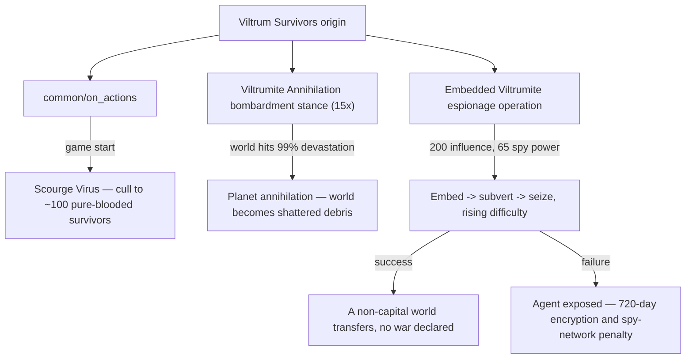

<p align="center">
  
</p>

<h1 align="center">Viltrum Empire</h1>

<p align="center">
  <b>A total-conversion Stellaris mod that drops the <em>Invincible</em> universe into the galaxy.</b>
</p>
<p align="center">
  Seven canon factions, an asymmetric lore-accurate balance, and event chains<br />
  that cull the Viltrumite race and shatter worlds to debris.
</p>

<p align="center">
  <a href="https://steamcommunity.com/sharedfiles/filedetails/?id=3602982845"></a>
  
  
  
  
  
</p>

<br />

## Why Viltrum Empire

Most empire packs hand you a fresh flag and the same balanced stat spread as everyone else. This mod does the opposite: it rebuilds seven *Invincible* factions from canon, then lets that canon dictate the numbers. The Viltrumites are so absurdly strong that they can barely reproduce; the GDA can only dig in and endure; and a start-of-game plague and a world-shattering bombardment stance make sure the fantasy plays out mechanically, not just in the flavor text.

<table width="100%">
  <tr>
    <td width="33%" valign="top">
      <h3 align="center">Play the Invincible universe</h3>
      <p align="center">Seven canon factions — Viltrumites, GDA, Thraxxans, Coalition, Sequids, Flaxans, and Martians — ship as playable species and ready-made empires.</p>
    </td>
    <td width="33%" valign="top">
      <h3 align="center">Asymmetric by design</h3>
      <p align="center">Balance is derived from canon, not min-maxing. The Pure Viltrumite trait grants 10000% army damage and near-immortal leaders, offset by -50% population growth — you conquer instead of grow.</p>
    </td>
    <td width="33%" valign="top">
      <h3 align="center">Signature event chains</h3>
      <p align="center">A Scourge Virus cull leaves roughly 100 elite survivors at game start, and a custom bombardment stance shatters worlds to debris at maximum devastation.</p>
    </td>
  </tr>
</table>

<br />

## Stack

| Layer | Technology |
| :--- | :--- |
| Content | Stellaris Clausewitz script (`common/`, `events/`, `prescripted_countries/`) |
| Target | Stellaris v4.4 (`supported_version="v4.4.*"` in `descriptor.mod`) |
| Portraits | Custom `VILTRUMITE` species class, 28 DDS portrait textures + portrait sets |
| Presentation | Six bespoke event pictures, a Viltrum flag with a map-mode variant |
| Localisation | English strings and tooltips; species class name in nine further languages |
| Distribution | Steam Workshop (`remote_file_id` 3602982845), or the local `mod` directory |

## Getting started

### Install

**Steam Workshop (recommended)** — [Subscribe on the Workshop](https://steamcommunity.com/sharedfiles/filedetails/?id=3602982845), launch Stellaris, and enable **Viltrum Empire** in the launcher's mod list.

**Manual** — place this mod folder inside your Stellaris `mod` directory so the launcher reads its `descriptor.mod`, then enable it in the launcher's playset:

| OS | Mod directory |
| :--- | :--- |
| Windows | `%USERPROFILE%\Documents\Paradox Interactive\Stellaris\mod\` |
| macOS | `~/Documents/Paradox Interactive/Stellaris/mod/` |
| Linux | `~/.local/share/Paradox Interactive/Stellaris/mod/` |

This is a **total conversion** built for **Stellaris v4.4** (per `descriptor.mod`). It reworks core content and is not intended to run alongside other major overhaul mods.

## Usage

Start a new game and pick one of the seven prescripted empires, or build your own using the mod's species and traits. Each empire pairs a species with its own authority, ethics, civics, custom origin, and ruler.

| Empire | Species | Ruler | Identity |
| :--- | :--- | :--- | :--- |
| **Viltrum Empire** | Viltrumites | Grand Regent Thragg | Dictatorial xenophobe-militarist on the **Viltrum Survivors** origin |
| **Global Defense Agency** | Humans | Director Cecil Stedman | Earth's defensive establishment — research and fortify to hold the line |
| **Thraxxan Hive** | Thraxxans | Thraxxan Queen | Dictatorial authoritarian swarm — mining guilds and rapid expansion |
| **Coalition of Planets** | Coalition Species | Thaedus | Democratic xenophile-pacifist federation — diplomacy and liberty |
| **Sequid Consciousness** | Sequids | Prime Sequid | Dictatorial materialist hegemony — infiltration and shadow politics |
| **Flaxan Empire** | Flaxans | Flaxan Emperor | Fanatic militarist dictatorship — warrior culture and fast fleets |
| **Martian Confederacy** | Martians | Commander Levy | Oligarchic militarist junta — warrior culture and a police state |

### What each species plays like

Every faction has one bespoke species-trait file, so no two play alike:

| Trait | Belongs to | What it does |
| :--- | :--- | :--- |
| **Pure Viltrumite** | Viltrumites | +5,000 leader lifespan, 10000% army damage & health, +30% research speed, +25% edict fund, perfect habitability — all offset by **-50% population growth** |
| **GDA Training** | Humans | +10% engineering research, +10% ship hull & hull regen, +2 defense platform capacity, +5% happiness, +10% unity — a fortify-and-hold defense game |
| **Swarm Biology** | Thraxxans | +25% pop assembly, +15% mineral & +10% worker output, -15% building cost — an industrial swarm that is short-lived (-70 years) and weak in melee |
| **Coalition Diplomacy** | Coalition | +25% trust growth, +15% diplomatic weight, +10% admin cap, +15% amenities & ethic attraction — wins through diplomacy, not war |
| **Parasitic Control** | Sequids | +2 encryption & decryption, +15% physics research, +25% slave political power — infiltrators with physically fragile armies |
| **Temporal Acceleration** | Flaxans | +25% ship speed, +15% evasion, +25% army damage, +20% pop assembly — fast, evasive raiders who age quickly |
| **Martian Warrior** | Martians | +25% army damage, +15% morale, +10% ship hull, +10% habitability — hardy fighters, but rebellious and crime-prone |

The **Viltrumites** are the dominant warrior race: superhuman combat stats and a 5,000-year lifespan that mirror their canonical invincibility, but they can barely grow. The **Global Defense Agency**'s humans lean on engineering and durability to survive. The other five factions each fill a distinct niche — an industrial swarm, a diplomatic federation, parasitic infiltrators, dimensional raiders, and rebellious warriors — with their own trait file and per-species name list.

### The event chains

The chains are wired through custom `on_actions` and back their pop-ups with six bespoke event pictures:

- **Scourge Virus** (`viltrum_start_pops`) fires at game start for Viltrum Survivors empires, culling the population from billions down to roughly 100 elite pure-blooded survivors — the mechanical reason Viltrumites must conquer rather than expand.
- **Planet annihilation** (`viltrum_annihilation`) pairs the **Viltrumite Annihilation** bombardment stance (15x planet damage, only for the Viltrum Survivors origin) with an event that converts any world reaching **99% devastation** into uninhabitable shattered debris.
- **Embedded Viltrumite** (`viltrum_espionage`) is a subterfuge espionage operation, again gated on the Viltrum Survivors origin: 200 influence and 65 spy power buy a three-stage infiltration — embed, subvert, seize, at rising difficulty — that transfers a non-capital world of the target empire outright, with no war declaration. A failed roll exposes the agent instead, hitting the operator with a 720-day encryption and spy-network penalty.

## Architecture



## How it works

- **Canon drives the numbers.** Each faction is one species definition plus one trait file, tuned to its *Invincible* portrayal rather than to a balanced curve — extreme highs paid for with extreme lows.
- **Prescripted empires are self-contained.** The seven files in `prescripted_countries/` bind a species to its authority, ethics, civics, origin, flag, and ruler, so they spawn ready to play (and as AI opponents).
- **Origins gate the mechanics.** The **Viltrum Survivors** origin is what unlocks the Scourge Virus start, the annihilation bombardment stance, and the Embedded Viltrumite espionage operation; only empires on that origin get them.
- **Presentation is native.** All player-facing text lives in one English localisation file with Stellaris color-coded tooltips, backed by a custom Viltrumite species class carrying 28 bespoke Viltrumite portraits, and a Viltrum flag with a map-mode variant.

## Project structure

```
descriptor.mod              Mod metadata (name, version, Workshop id, tags)
thumbnail.png               Workshop thumbnail
CHANGELOG.md                Release history
common/
  species/                  7 species definitions
  traits/                   7 species trait files + shared leader traits
  governments/civics/       7 faction origin/civic files (incl. Viltrum Survivors)
  name_lists/               7 per-species name lists
  species_classes/          Custom VILTRUMITE species class
  species_names/            Generated-species names for that class
  portrait_sets/            Viltrumite and human portrait sets
  portrait_categories/      Groups those sets in the empire creator
  on_actions/               Event triggers
  bombardment_stances/      Viltrumite annihilation stance
  espionage_operation_types/  Embedded-agent infiltration operation
  static_modifiers/         Espionage operation modifiers
events/                     Scourge Virus, planet annihilation + espionage events
prescripted_countries/      7 playable prescripted empires
flags/viltrum/              Custom Viltrum flag (+ map-mode variant)
gfx/event_pictures/         Event picture textures
gfx/models/portraits/       28 Viltrumite portrait textures
gfx/portraits/portraits/    Viltrumite portrait group definitions
interface/                  Event picture sprite definitions
localisation/english/       English strings and tooltips
localisation/<lang>/        Species class name in nine other languages
```

## License

Proprietary — Copyright (c) 2026 Trenton Taylor. All rights reserved. No permission is granted to use, copy, modify, or distribute the software. See [LICENSE.md](LICENSE.md).

<br />

<p align="center">
  <sub>Seven factions, one galaxy — conquer it as the race too strong to grow.</sub>
</p>
